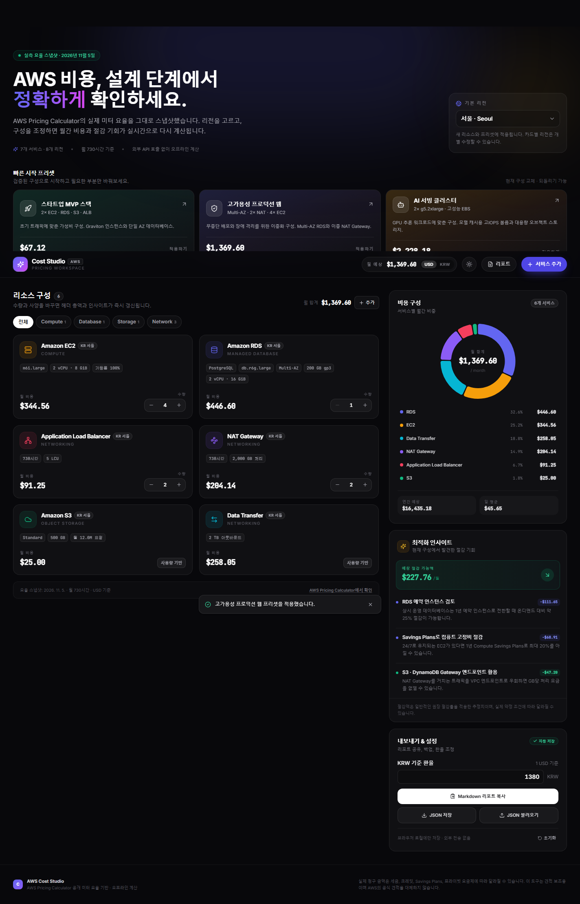
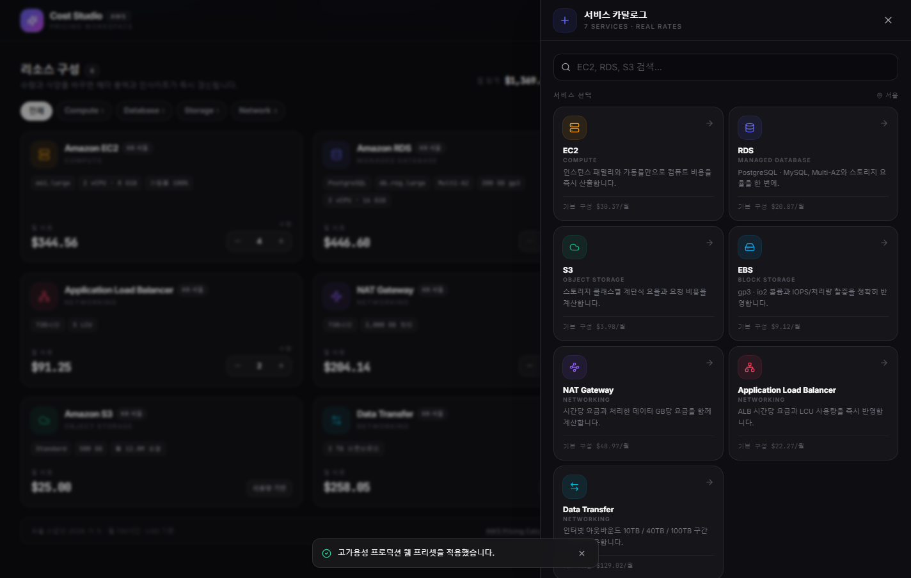
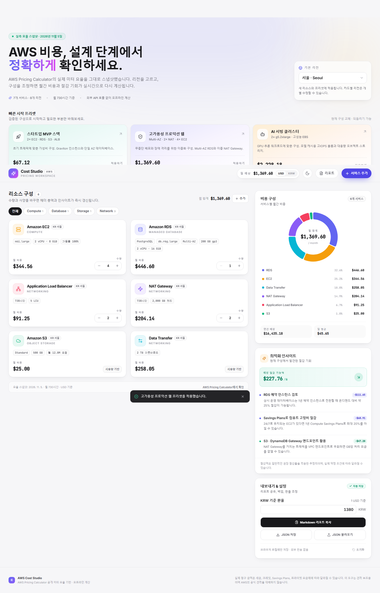

# AWS Cost Studio · 비용 계산기

> 리전별 실제 AWS 요율 데이터로 설계하는 초고속 클라우드 인프라 아키텍처 비용 계산기 & FinOps 스튜디오

[](https://unihit.github.io/aws-cost-studio/)



---

## 🌟 주요 기능 (Key Features)

- **AWS 공식 Pricing Calculator 실측 요율 연동 & 8대 리전 비교 매트릭스**:
  - `ap-northeast-2 (서울)`을 포함한 8대 핵심 리전(`서울`, `도쿄`, `싱가포르`, `시드니`, `버지니아`, `오리건`, `프랑크푸르트`, `아일랜드`)의 최신 온디맨드 단가 데이터 내장
  - **8대 글로벌 리전 실시간 비용 비교 매트릭스**: 현재 아키텍처의 리전별 총액 및 최저가 절감률을 한눈에 비교하고 원클릭 일괄 전환 지원
- **15개 핵심 인프라 서비스 정밀 산출**:
  - **Amazon ECS (AWS Fargate)**: 서버리스 컨테이너 태스크(vCPU / Memory 규격), Arm64(Graviton 20% 할인) vs x86_64, Fargate Spot(최대 70% 할인), 20GB 초과 임시 스토리지(Ephemeral Storage), 태스크 수량 및 월간 가동 시간 정밀 계산
  - **Amazon EC2**: Graviton(`t4g`, `m6g`, `c7g`, `r7g`), Intel(`m6i`, `c6i`), GPU(`g4dn`, `g5`) 등 최신 인스턴스 패밀리 및 월간 가동률(%) 반영
  - **Amazon EBS**: gp3, io2 볼륨 스토리지 요금 및 프로비저닝 IOPS / Throughput 할증 정밀 계산
  - **Amazon RDS & Aurora**: PostgreSQL / MySQL 프로비저닝 인스턴스 및 **Aurora Serverless v2 (ACU 오토스케일링)**, Multi-AZ 구성, gp3 용량 구간별(400GB 기준) 기본 IOPS/처리량 무료 제공분 통합 계산
  - **Amazon DynamoDB**: On-Demand(50% 요율 인하 반영 · WRU/RRU) 및 Provisioned(WCU/RCU) 용량 모드, 25GB 상시 무료 티어 및 테이블 스토리지 계산
  - **Amazon ElastiCache**: Valkey(20% 할인) · Redis OSS 인메모리 캐시 노드, 복제본(Replica), 백업 스토리지 계산
  - **Amazon S3**: Standard, Glacier Deep Archive 등 스토리지 계단식 요율 및 요청(PUT/GET) 단가
  - **AWS Lambda & API Gateway**: Arm64(Graviton2) / x86_64 실행 단가, 상시 프리티어 공제, HTTP API Gateway 요청 비용 합산
  - **Amazon EKS**: 클러스터 컨트롤 플레인 고정비($0.10/h) · 확장 버전 지원 · 관리형 워커 노드 통합 산출
  - **Amazon CloudFront**: 매월 1TB 무료 아웃바운드 및 1,000만 건 무료 HTTPS 요청 티어가 반영된 글로벌 엣지 CDN 비용
  - **NAT Gateway**: 인스턴스 시간당 요금 + 처리 데이터(GB) 비용
  - **Elastic Load Balancing (ALB / NLB)**: L7 Application Load Balancer(LCU) 및 초저지연 L4 Network Load Balancer(NLCU · 25% 저렴) 시간당 기본 요금과 용량 단위 통합 계산
  - **AWS Transit Gateway (TGW)**: 리전별 Attachment 시간당 요금(서울/도쿄 $0.07/h, 미국 $0.05/h, 유럽/아시아 $0.06/h) 및 처리 데이터($0.02/GB) 비용
  - **AWS Site-to-Site VPN**: IPsec VPN 연결 시간당 기본 요금($0.05/h · 이중화 터널 2개 포함), Global Accelerator 기반 가속화 VPN(+$0.05/h) 옵션 및 아웃바운드 데이터 전송 비용
  - **Data Transfer**: 인터넷 아웃바운드 구간별(10TB, 40TB, 100TB) 티어링 요율 자동 적용
- **약정 할인 모델 · AWS Support 플랜 · 부가세(VAT 10%) 통합 계산**:
  - 온디맨드 정가 대비 1년·3년 Savings Plans / Reserved Instances 절감액 즉시 비교
  - **AWS Support Plan (Basic 무료 / Developer 3% / Business 구간별 10%~3%)** 및 **국내 부가세(VAT 10%)** 토글 지원
  - **월 목표 예산(Budget) 게이지** 설정 및 예산 초과 경고 표시
- **실측 기반 FinOps 인사이트 & 원클릭 최적화**:
  - x86 인스턴스를 동급 Graviton(Arm) 실제 단가로 비교 후 **원클릭 전환**
  - ECS Fargate Arm64 전환(20% 절감), Fargate Spot 전환(70% 절감), ElastiCache Redis → Valkey(20% 할인), Lambda x86 → Arm64(20% 할인), 1년 약정 전환 원클릭 적용
- **리소스 검색 · 정렬 · 별칭(Custom Label) · 환경 태그 (`PROD` / `STAGE` / `DEV`)**:
  - 별칭/서비스/인스턴스 실시간 검색 및 비용 높은순/낮은순/이름순/추가순 정렬, 단축키(`Ctrl+K` / `/`) 지원
- **Excel(CSV) · PDF 인쇄 · URL 공유 링크 & 실시간 환율 연동 (USD / KRW)**:
  - 백엔드 없이 URL 파라미터(`?s=...`) 하나로 동료에게 즉시 견적 공유
  - 한글 깨짐 없는 **Excel(CSV, UTF-8 BOM)** 다운로드, **PDF/인쇄 최적화(`@media print`)**, Markdown/JSON 내보내기 지원

---

## 🖥️ 스크린샷 (Screenshots)

| 서비스 추가 드로어 (Dark) | 라이트 모드 대시보드 |
| :---: | :---: |
|  |  |

---

## 🛠️ 기술 스택 (Tech Stack)

- **Frontend**: React 18, TypeScript, Vite (Code Splitting & Manual Chunks 최적화)
- **Styling**: Tailwind CSS, PostCSS, Lucide Icons
- **Data Visualization**: Recharts (도넛 차트 및 카테고리별 비용 시각화)
- **Deployment**: GitHub Pages (`gh-pages`)

---

## 🚀 로컬 실행 방법 (Getting Started)

```bash
# 1. 저장소 복제
git clone https://github.com/unihit/aws-cost-studio.git
cd aws-cost-studio

# 2. 의존성 패키지 설치
npm install

# 3. 개발 서버 실행
npm run dev

# 4. 프로덕션 빌드
npm run build
npm run preview
```

---

## 📄 라이선스 (License)

MIT License. AWS 요율 데이터는 Amazon Web Services 공개 요율표를 기반으로 합니다.
